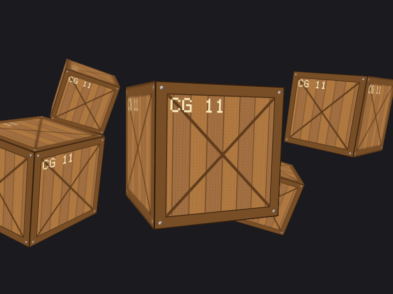

# 11-апта: суретті файлдан жүктеу, текстура объектісі және параметрлері

C++17 · OpenGL 3.3 Core · GLFW · GLEW · GLM · stb_image · CMake (Ubuntu / WSL)

```bash
sudo apt install build-essential cmake libglfw3-dev libglew-dev libglm-dev
cmake -S . -B build && cmake --build build
./build/cg                       # кез келген бумадан жұмыс істейді (ASSET_DIR)
```

Іске қосқанда терминалда `.../assets/container.png  512x512  арна: 3` шығады.

> **`container.png` туралы.** Тапсырмамен берілген файл қолымда болмағандықтан, сол өлшемде (512×512, 3 арна)
> ағаш жәшік суретін `tools/make_container.py` жасайды. Суретте сол жақ жоғарыда «CG 11» жазуы бар —
> ол төңкерілу/айна көрінісін бірден байқатады. Ресми файл болса, `assets/container.png` орнына қойса болады.

Басқару: `W A S D` жылжу, `Space`/`Left Shift` жоғары/төмен, `Left Ctrl` жүгіру, тінтуір — бұрылу,
дөңгелек — zoom, `1 2 3 4` — wrap (REPEAT / MIRRORED / EDGE / BORDER), `N` / `L` — MAG (NEAREST / LINEAR),
`M` — MIN (LINEAR ↔ LINEAR_MIPMAP_LINEAR), `[` `]` — `uvScale` (0.5…8.0), `T` — tint, `F` — су, `Z` — анизотропия, `Esc` — шығу.

## Базалық бөлім

`stb_image.h` → `external/stb/`; `#define STB_IMAGE_IMPLEMENTATION` — `#include`-тан бұрын; `vertices[]` — позиция + UV (stride 5,
CCW реті сақталған); екі `glVertexAttribPointer` та stride = 5, UV — 2 компонент; шейдерде `texture()`;
`loadTexture()` ішінде `glGenerateMipmap` — `glTexImage2D`-ден кейін, `fmt` арна санынан анықталады, `stbi_image_free`.



Тексеру: терминалда өлшем мен арна шығады ✔ · алты жақта да сурет бар ✔ · жазу дұрыс оқылады (төңкерілмеген) ✔ ·
алыстағы кубтарда mipmap қосулы (`GL_LINEAR_MIPMAP_LINEAR`), сондықтан шуыл мен жыпылық азаяды (стильдік скриншоттармен салыстыру — 3-тапсырма).

## Скриншоттар

Скриншоттар `--shot` флагымен түсірілген (10-аптадағыдай, `tools/ppm2png.py`).

| Файл | Тапсырма | Команда |
|---|---|---|
| `01-basic.png` | базалық | `./build/cg --shot a.ppm` |
| `02-repeat.png` | 1 | `--uv-mul 2 --wrap repeat` |
| `03-mirrored.png` | 1 | `--uv-mul 2 --wrap mirror` |
| `04-clamp-edge.png` | 1 | `--uv-mul 2 --wrap edge` |
| `05-clamp-border.png` | 1 | `--uv-mul 2 --wrap border` |
| `06-nearest.png` / `07-linear.png` | 2 | `--uv-mul 0.1 --fov 8 --mag nearest|linear` |
| `08-no-mipmap.png` / `09-mipmap.png` | 3 | `--far --fov 12 --cam 0,0,-20 --min linear|mipmap` |
| `10-black-cube.png` | 4 | `--min nomip` (төменде түсіндірілген) |
| `10b-mag-bad-not-black.png` | 4 | `--mag bad` |
| `Q4-aniso-off.png` / `Q4-aniso-on.png` | Қ4 | `--floor --cam 0,0.5,3 --pitch -8 [--aniso]` |

## 1-тапсырма. Ораумен жұмыс режимдері (UV × 2)

`--uv-mul 2` UV мәндерін GPU-ға жібермес бұрын 2-ге көбейтеді. `GL_REPEAT`-та әр жақта сурет 2×2 болып қайталанады.

| Режим | Қашан қолайлы |
|---|---|
| `GL_REPEAT` | қайталанатын (tileable) текстуралар: еден, қабырға, шөп, кірпіш |
| `GL_MIRRORED_REPEAT` | тігіссіз емес текстураны жасырын қайталау; симметриялы өрнектер |
| `GL_CLAMP_TO_EDGE` | UI/спрайттар, skybox, 0..1 шегінен шыққанда шеткі пиксельді созу (шекарада артефакт болмауы керек жағдай) |
| `GL_CLAMP_TO_BORDER` | шегінен тыс аймақты бөлек түспен (қызыл) белгілеу: debug, декаль, маска, көлеңке карталары |

**Қорғау сұрағы.** Айырмашылық UV > 1 болатын жерде, яғни қайталану шекарасында көрінеді. `GL_REPEAT`-та тігіс **байқалады**:
оң шеттен кейін сурет сол шеттен қайта басталады, сондықтан шекарада екі әртүрлі пиксель қатар тұрады (жәшіктің рамасы
мен «CG 11» жазуы кенеттен секіреді). `GL_MIRRORED_REPEAT`-та әрбір келесі көшірме айнадағы бейнедей — шекарада екі жағынан
да бірдей пиксель тұрады, сондықтан тігіс **байқалмайды** (бірақ жазу айнадағыдай төңкеріледі).

## 2-тапсырма. NEAREST пен LINEAR

`--uv-mul 0.1`, fov = 8°, камера бірдей қашықтықта: `06-nearest.png` — шаршы пикселдер, `07-linear.png` — жұмсақ ауысу.

**Қорғау сұрағы.** Пиксель-арт ойынында **`GL_NEAREST`**: әр texel анық шаршы болып қалады, сурет бұлыңғырланбайды, түстер
араласып кетпейді — автордың тұрақты қатқыл пиксельдері сақталады. Фотореалистік ойында **`GL_LINEAR`** (mipmap-пен): үлкейткенде
texel-дер арасында жұмсақ интерполяция беріп, блоктық «пикселизацияны» жасырады.

## 3-тапсырма. Mipmap әсері

`--far` z ≈ −40 маңына 6 куб қосады. `08-no-mipmap.png` (`GL_LINEAR`) және `09-mipmap.png` (`GL_LINEAR_MIPMAP_LINEAR`).

**Бір сөйлем.** Mipmap-сыз алыстағы жәшіктің бетінде тақтай сызықтары мен шегелер дақ-дақ, шуыл болып көрінеді (камера қозғалса жыпылықтайды),
mipmap-пен тегіс, тұрақты бейне.

**Қорғау сұрағы (есептеу).** 512×512 текстурасы бар куб экранда 20×20 пиксель болса, жаққа 512×512 = 262 144 texel, ал 20×20 = 400 пиксель:
262 144 / 400 ≈ **655 texel бір фрагментке** (әр өс бойынша 512 / 20 ≈ 25,6 texel). Mipmap-сыз `GL_LINEAR` тек 4 texel
оқиды (2×2), қалған ~650-і елеусіз қалады, сондықтан шуыл мен жыпылық шығады. Mipmap деңгейі `log2(25,6) ≈ 4,7`
таңдалады, яғни 32×32 және 16×16 деңгейлер: 32×32 = 1024 texel / 400 пиксель ≈ **2,6 texel**, 16×16 = 256 / 400 ≈ **0,64 texel**
бір пикселге. Трилинейлік сүзгі осы екі деңгейдің арасын араластырады (≈ 8 texel оқиды), яғни ~655 орнына бір фрагментке шамамен 1–3 texel
сәйкес келеді.

## 4-тапсырма. Қара куб

`10-black-cube.png` — қара куб. **Маңызды ескерту:** тапсырмада сипатталғандай `GL_TEXTURE_MAG_FILTER`-ге
`GL_LINEAR_MIPMAP_LINEAR` қойғанда менің құрылғымда (Ubuntu/WSLg, Mesa) куб қара **болмады** (`10b-mag-bad-not-black.png`).
Себебі бұл — `GL_INVALID_ENUM` (0x0500) қатесі: MAG үшін тек `GL_NEAREST`/`GL_LINEAR` жарамды, драйвер қате шақыруды елемейді, фильтр
әдепкі `GL_LINEAR` болып қалады. Бағдарлама `glGetError()` арқылы мұны көрсетеді (`glGetError після параметрлер: 0x0500`).
Қара кубты шын көрсету үшін сол тектес жиі кездесетін қатені қолдандым: **MIN-ге mipmap сүзгісі қойып, `glGenerateMipmap` шақырмау**
(`--min nomip`) — mipmap-тізбегі толық емес, текстура «incomplete», сэмплер `(0,0,0,1)` — қара түс қайтарады. Түзету:
`glTexImage2D`-ден кейін `glGenerateMipmap(GL_TEXTURE_2D)` шақыру (немесе MIN-ді `GL_LINEAR` қою); MAG-тағы қателікте — `GL_LINEAR` қою.

**Қорғау сұрағы.** Өз кодымда мұндай қатені былай табар едім: `glGetError()` — MAG-қа mipmap берілген жағдайда **көмектеседі**
(`GL_INVALID_ENUM`, жоғарыда көрсетілген), бірақ incomplete текстура үшін көмектеспейді — қате жоқ, тек қара түс. Ол жағдайда
`glGetTexParameter*`/RenderDoc-пен параметрлерді тексеремін, `stbi_load` нәтижесін, байлау мен шейдер `uniform`-ын қарастырамын.
Қара кубтың басқа себептері:
1. **сурет жүктелмеді** (`stbi_load` → `nullptr`, жол қате) — текстура бос қалады;
2. **текстура байланбаған** (`glBindTexture` не `glActiveTexture` жоқ, сэмплер басқа бірлікке қарайды);
3. **mipmap жоқ** (MIN сүзгісі mipmap, бірақ `glGenerateMipmap` шақырылмаған) — осы скриншот;
4. UV шектен тыс + `GL_CLAMP_TO_BORDER` және шекара түсі әдепкі қара (0,0,0,0);
5. шейдерде `ourTexture`-ге дұрыс емес uniform / `aTexCoord` атрибуты қосылмаған (`glEnableVertexAttribArray(1)` жоқ).

## 5-тапсырма. `uvScale` пернемен (`[` `]`)

Шейдерде `FragColor = texture(ourTexture, vTexCoord * uvScale);`, `uvScale` 0,5…8,0 аралығында `2.0f * dt` жылдамдықпен өзгереді
(`dt`-ге көбейтілген, себебі перне басулы тұрғанда үздіксіз әрекет; кадр жиілігіне тәуелсіз). `uvScale = 4` кезінде сурет әр жақта 4×4 болып қайталанады.

**Қорғау сұрағы.** UV-ді `vertices[]` ішінде көбейтсең, масштаб бағдарлама жазылған кезде бекітіледі: VBO-ны қайта жүктемейінше
өзгертуге болмайды, бірақ шейдерде қосымша есептеу жоқ (аздап **жылдамырақ**). Шейдерде (`uvScale` uniform) көбейтсең, масштабты
әр кадрда, әр объектке бөлек өзгертуге болады (**икемдірек**), ал құны — бір көбейту/фрагмент (іс жүзінде елеусіз, оны вершина шейдеріне
көшіріп, вершина санына қарай азайтуға да болады). Сондықтан статикалық масштаб — vertices[], динамикалық — uniform.

## Орындалған қосымша тапсырмалар

- **Қ2.** `T` — `tint` uniform, түс уақыт бойынша өзгереді (`FragColor = texture(...) * vec4(tint, 1.0)`).
- **Қ3.** `F` — ағып жатқан су: UV `time * 0.1` жылжиды (`GL_REPEAT` қосулы).
- **Қ4.** `Z` / `--aniso` — `GL_TEXTURE_MAX_ANISOTROPY_EXT`; еденді имитациялайтын жалпақ куб (`--floor`), скриншоттар: `Q4-aniso-off.png` / `Q4-aniso-on.png`.
- **Қ1.** `--tex файл` өз суретіңді жүктейді; `fmt` логикасы төрт арналы PNG-ді (`GL_RGBA`) өңдейді, бірақ төрт арналы файлмен нақты сынап көрмедім.

## Қате шықса

Тапсырмадағы кестеге сәйкес тексерілді: `#define STB_IMAGE_IMPLEMENTATION` `#include`-тан бұрын, `ASSET_DIR` арқылы жол, stride екі жерде де 5,
`glGenerateMipmap` шақырылған, MAG сүзгісінде mipmap тұрақтысы жоқ (`--mag bad` тек сынақ үшін).
